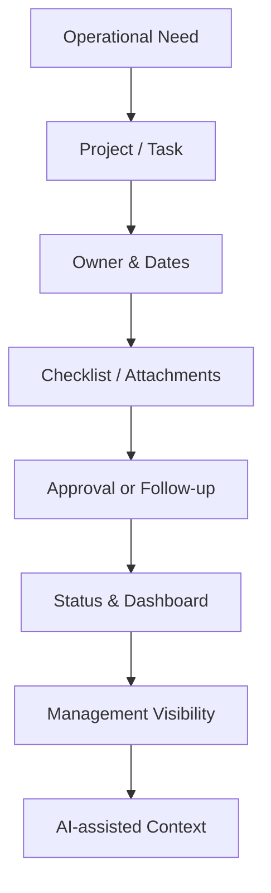

# ASAGI — Executive Operations Workspace

> Sanitized case study. Internal company information and production source code remain private.

## Context

Projects, tasks, approvals, documents, and management follow-up become difficult to control when they are distributed across messages, spreadsheets, and separate tools.

## Objective

Create one structured workspace for operational follow-up while keeping actions traceable and easy to understand.

## Operating Model

## Scope

- Projects and task management
- Multi-date and phase-oriented workflows
- Employee requests and approvals
- Checklists, reminders, and attachments
- Role-aware interfaces
- Operational dashboard views
- Contextual AI assistance
- Testing and deployment workflows

## My Contribution

- Translate management needs into structured modules
- Define workflow states, permissions, and validation behavior
- Coordinate business logic, UI behavior, and data structure
- Test critical flows and document changes
- Keep operational decisions human-owned while using AI for assistance

## Technology

React · TypeScript · Supabase · PostgreSQL · Edge Functions · automated testing · AI services

## What This Demonstrates

**Business systems · operations design · approvals · project coordination · requirements translation · AI-assisted operations**
